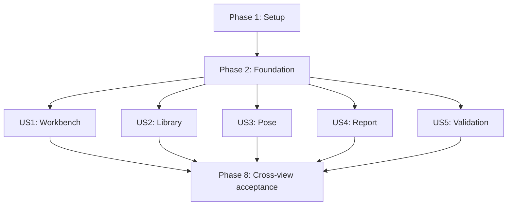

# Tasks: Demoable Workbench UI

**Input**: Design documents from `specs/002-build-demo-ui/`

**Prerequisites**: `plan.md`, `spec.md`, `research.md`, `data-model.md`, `contracts/`, `quickstart.md`

**Tests**: Tests are required by FR-030, SC-012, the validation matrix, and the project constitution. Within each user-story phase, create the listed tests first and confirm they fail for the missing behavior before implementation.

**Organization**: Tasks are grouped by user story so each story can be implemented and validated as an independent increment after the shared foundation is complete.

## Format: `[ID] [P?] [Story] Description`

- **[P]**: Can run in parallel after its phase prerequisites because it changes different files and does not depend on another incomplete task marked in the same group.
- **[Story]**: Maps the task to User Story 1 through User Story 5 from `spec.md`.
- Every task names the exact repository file or directory it changes.

## Phase 1: Setup (Shared Infrastructure)

**Purpose**: Establish durable feature-module and test entry points without changing the selected stack or adding production dependencies.

- [X] T001 Create feature and shared-UI module skeletons with placeholder page exports in `apps/web/src/components/ui/index.ts`, `apps/web/src/rendering/charts/index.ts`, `apps/web/src/features/workbench/WorkbenchPage.tsx`, `apps/web/src/features/library/LibraryPage.tsx`, `apps/web/src/features/pose/PosePage.tsx`, `apps/web/src/features/report/ReportPage.tsx`, and `apps/web/src/features/validation/ValidationPage.tsx`
- [X] T002 [P] Expand focused test and browser scripts for the five product views in `package.json`, `vitest.config.ts`, and `playwright.config.ts`
- [X] T003 [P] Add shared provider-aware render helpers and deterministic fixture builders in `apps/web/tests/test-utils.tsx` and `tests/fixtures/ui/demo-fixtures.ts`

**Checkpoint**: The existing app builds with durable feature entry points and all planned test suites are addressable.

---

## Phase 2: Foundational (Blocking Prerequisites)

**Purpose**: Implement the validated cross-story schemas, worker capabilities, immutable run storage, application state, service boundaries, shared shell, and session recovery behavior.

**CRITICAL**: No user-story implementation begins until this phase passes its schema, worker, storage, state, and shared-component tests.

- [X] T004 [P] Write failing schema tests for capability manifests, input steps/groups, model metadata, run artifacts, presets, validation checks, and session references in `packages/schema/tests/application-contracts.test.ts`
- [X] T005 [P] Extend failing worker contract tests for granular supported input/output capabilities and explicit provider source values in `tests/contracts/physics-worker.test.ts`
- [X] T006 Extend and validate input steps/groups in `packages/schema/src/input-contract.ts` and `packages/schema/src/input-contracts/spike-controls.ts`
- [X] T007 Add strict shared schemas and exports for `SolverCapabilityManifest`, `ModelMetadata`, `RunArtifact`, `Preset`, `ValidationCheck`, and session references in `packages/schema/src/application.ts` and `packages/schema/src/index.ts`
- [X] T008 Upgrade the ready/result protocol and both real/fixture adapters to emit validated capabilities and source metadata in `packages/schema/src/worker-protocol.ts`, `apps/web/src/solver/physics.worker.ts`, and `apps/web/src/solver/fixture.worker.ts`
- [X] T009 Write failing snapshot, legacy-record, immutability, buffer-copy, and quota tests in `apps/web/tests/integration/persistence.test.ts`
- [X] T010 Add the snapshot-aware run-record migration and immutable repository operations in `apps/web/src/storage/database.ts` and `apps/web/src/storage/repositories.ts`
- [X] T011 Write failing scenario-working-copy, stale-result, solver lifecycle, baseline, and stale-reference transition tests in `apps/web/src/state/store.test.ts`
- [X] T012 Refactor the Zustand store into validated scenario, immutable run, solver, baseline, and view/session slices in `apps/web/src/state/store.ts`
- [X] T013 Write failing restore, corrupt-field isolation, disabled stale-reference, clear, and replace tests in `apps/web/tests/integration/session-continuity.test.ts`
- [X] T014 Implement session-scoped continuity without storing artifacts or buffers in `apps/web/src/state/session-continuity.ts`
- [X] T015 Define injectable `ScenarioCatalog`, `SolverGateway`, `RunArtifactRepository`, `BaselineComparator`, `ValidationRunner`, `FrameExporter`, and structured error contracts in `apps/web/src/app/services.ts` and wire them through `apps/web/src/app/AppProviders.tsx`
- [X] T016 [P] Write failing shared-shell, primary-action, source-label, stale-reference, field, segmented-control, and table accessibility tests in `apps/web/tests/unit/ui-components.test.tsx`
- [X] T017 Promote the spike button, field, option-control, data-display, and table primitives into `apps/web/src/components/ui/Button.tsx`, `apps/web/src/components/ui/Field.tsx`, `apps/web/src/components/ui/OptionControls.tsx`, `apps/web/src/components/ui/DataDisplay.tsx`, `apps/web/src/components/ui/DataTable.tsx`, and `apps/web/src/components/ui/index.ts`
- [X] T018 Implement the shared topbar/navigation, status/source labels, primary-action slot, callout, and stale-reference recovery UI in `apps/web/src/components/ui/AppShell.tsx`, `apps/web/src/components/ui/Status.tsx`, `apps/web/src/components/ui/Callout.tsx`, and `apps/web/src/components/ui/StaleReference.tsx`
- [X] T019 Port rendered-prototype tokens, typography, focus, stable-control sizing, stage, table, and base responsive rules into `apps/web/src/styles.css`
- [X] T020 Compose providers and all five canonical routes, including `/report/:runId` and deterministic root/unknown fallbacks, in `apps/web/src/App.tsx` and `apps/web/src/main.tsx`

**Checkpoint**: Shared contracts pass; the router and shell render all five placeholders; stale references are recoverable; no story-specific physical or visual behavior is fabricated.

---

## Phase 3: User Story 1 - Explore and Solve a Jump Scenario (Priority: P1) - MVP

**Goal**: Deliver a standalone Workbench that edits solver-supported inputs, explicitly solves through the real worker, replays immutable frames, toggles overlays without re-solving, presents source-honest metrics, and pins compatible baselines.

**Independent Test**: Open `/workbench` with the standard scenario, verify supported and awaiting-core controls, change a supported input, select Solve Run, replay/scrub deterministic frames, toggle overlays, and pin a baseline while confirming presentation actions dispatch no solve.

### Tests for User Story 1

- [X] T021 [P] [US1] Write failing Workbench selector, capability gating, stale-result, solve, playback, and baseline component/state tests in `apps/web/tests/unit/workbench.test.tsx`
- [X] T022 [P] [US1] Write the failing keyboard and primary Workbench browser workflow with stable `data-od-id` assertions in `tests/e2e/workbench.spec.ts`
- [X] T023 [P] [US1] Write failing frame-0, takeoff, mid-flight, landing, baseline-overlay, nonblank-canvas, and desktop/tablet visual checks in `tests/visual/workbench.spec.ts`

### Implementation for User Story 1

- [X] T024 [US1] Implement initialization, explicit solve/cancel, monotonic progress, late-result rejection, pose sampling, and speed-window operations in `apps/web/src/solver/gateway.ts` and `apps/web/src/solver/controller.ts`
- [X] T025 [US1] Implement Workbench scenario selectors, validated control updates, capability resolution, stale-result transitions, and view preferences in `apps/web/src/features/workbench/useWorkbench.ts`
- [X] T026 [P] [US1] Build grouped Jump, Landing, Entry, Rider, and Bike controls with disabled awaiting-core states in `apps/web/src/features/workbench/InputRail.tsx`
- [X] T027 [P] [US1] Extend deterministic terrain, bike/rider, baseline, COM, force, velocity, torque, suspension, legend, camera, and fallback rendering in `apps/web/src/rendering/canvas/workbench-stage.ts` and `apps/web/src/features/workbench/WorkbenchStage.tsx`
- [X] T028 [P] [US1] Promote immutable frame playback, keyboard commands, phase timeline, speed, scrub, and no-solve presentation controls in `apps/web/src/features/workbench/usePlayback.ts` and `apps/web/src/features/workbench/Transport.tsx`
- [X] T029 [P] [US1] Implement compatibility evaluation, solver-version warnings, blank incompatible deltas, and grouped source-honest metrics in `apps/web/src/features/workbench/baseline-comparator.ts` and `apps/web/src/features/workbench/MetricsRail.tsx`
- [X] T030 [US1] Assemble exact scenario snapshots, hashes, model metadata, frame/telemetry buffers, and recoverable persistence errors into immutable artifacts in `apps/web/src/features/workbench/solve-run.ts`
- [X] T031 [US1] Replace the Workbench placeholder with every Workbench `data-od-id` from `specs/002-build-demo-ui/contracts/ui-regions.md`, loading/unsolved/stale/solving/solved/error states, one primary action, and scope disclosures in `apps/web/src/features/workbench/WorkbenchPage.tsx`
- [X] T032 [US1] Expose deterministic frame selection and solve-dispatch counters for browser tests without changing production behavior in `apps/web/src/test-hooks.ts`

**Checkpoint**: User Story 1 passes its unit, worker, E2E, visual, source-honesty, keyboard, and performance assertions as an independently demoable Workbench MVP.

---

## Phase 4: User Story 2 - Find and Load a Starting Scenario (Priority: P1)

**Goal**: Deliver a searchable four-category preset library with immutable presets, geometry-derived thumbnails, measured/unavailable speed-window states, and validated create/load/duplicate handoffs.

**Independent Test**: Open `/library`, filter every category by name/tag/note, clear with Escape, inspect counts and no-results state, load a preset, duplicate it with a new identity, and verify unavailable entry guidance is worded instead of rendered as zero.

### Tests for User Story 2

- [X] T033 [P] [US2] Write failing catalog validation, search/count, immutable load/duplicate, and speed-window state tests in `apps/web/tests/unit/scenario-catalog.test.ts`
- [X] T034 [P] [US2] Write the failing keyboard search, category, empty-state, create/load/duplicate, Workbench handoff, and Library `data-od-id` contract workflow from `specs/002-build-demo-ui/contracts/ui-regions.md` in `tests/e2e/library.spec.ts`
- [X] T035 [P] [US2] Write failing desktop/tablet card-grid, internal-table-scroll, long-label, thumbnail, and no-window visual checks in `tests/visual/library.spec.ts`

### Implementation for User Story 2

- [X] T036 [US2] Create validated read-only jump, rider, bike, and movement preset fixtures with measured and unavailable guidance cases in `tests/fixtures/presets/catalog-v1.json` and `apps/web/src/features/library/presets.ts`
- [X] T037 [US2] Implement list/search/count/create/load/duplicate operations and memoized geometry-hash speed-window requests in `apps/web/src/features/library/scenario-catalog.ts`
- [X] T038 [P] [US2] Implement session-backed category/search state, slash focus, Escape clear, and stale selection handling in `apps/web/src/features/library/useLibrary.ts`
- [X] T039 [P] [US2] Reuse terrain geometry to draw deterministic preset thumbnails and build jump cards with guidance bars and actions in `apps/web/src/features/library/preset-thumbnail.ts` and `apps/web/src/features/library/JumpPresetCard.tsx`
- [X] T040 [US2] Build accessible rider, bike, and movement tables plus named empty/recovery states in `apps/web/src/features/library/PresetTables.tsx` and `apps/web/src/features/library/LibraryEmptyState.tsx`
- [X] T041 [US2] Replace the Library placeholder with every Library `data-od-id` from `specs/002-build-demo-ui/contracts/ui-regions.md`, tab counts, responsive views, one New Scenario action, and validated Workbench navigation in `apps/web/src/features/library/LibraryPage.tsx`

**Checkpoint**: User Story 2 independently demonstrates finding and handing off a valid scenario without mutating presets or inventing speed guidance.

---

## Phase 5: User Story 3 - Author a Rider Movement (Priority: P2)

**Goal**: Deliver a distance-relative Pose Editor with valid keyframe operations, immediate scenario application, constrained direct manipulation, synchronized track/joint/ROM views, and navigation without solving.

**Independent Test**: Open `/pose` with a valid scenario, navigate keys by keyboard, add/move/delete keys, change interpolation and targets, drag beyond reach, verify constrained finite output and immediate stale state, then select Apply to Run and confirm zero solve dispatches.

### Tests for User Story 3

- [X] T042 [P] [US3] Write failing key ordering/minimum, selection, immediate application, stale-result, interpolation, reset, and constrained-sample tests in `apps/web/tests/unit/pose-editor.test.tsx`
- [X] T043 [P] [US3] Write the failing listbox keyboard, focus-retention, edit, constraint, Apply-to-Run, and Pose `data-od-id` contract workflow from `specs/002-build-demo-ui/contracts/ui-regions.md` in `tests/e2e/pose.spec.ts`
- [X] T044 [P] [US3] Write failing neutral/authored/constrained/saturated nonblank-canvas and desktop/tablet visual checks in `tests/visual/pose.spec.ts`

### Implementation for User Story 3

- [X] T045 [US3] Implement stable key identities, sorted add/move/delete guards, target/interpolation/reset actions, immediate validated scenario writes, and stale-result transitions in `apps/web/src/features/pose/usePoseEditor.ts`
- [X] T046 [US3] Implement asynchronous pose sampling, stale-response rejection, finite constrained results, drag-to-target conversion, and saturation state in `apps/web/src/features/pose/pose-sampling.ts`
- [X] T047 [P] [US3] Build the arrow-key listbox, guarded delete affordances, add-at-playhead action, and interpolation control in `apps/web/src/features/pose/KeyframeRail.tsx`
- [X] T048 [P] [US3] Extend deterministic target/achieved/limit/COM/handle drawing and pointer manipulation in `apps/web/src/rendering/canvas/pose-stage.ts` and `apps/web/src/features/pose/PoseStage.tsx`
- [X] T049 [P] [US3] Build the clickable/draggable distance track and synchronized joint target, error, limit, ROM, and clip-summary panels in `apps/web/src/features/pose/DistanceTrack.tsx` and `apps/web/src/features/pose/JointRail.tsx`
- [X] T050 [US3] Replace the Pose placeholder with every Pose `data-od-id` from `specs/002-build-demo-ui/contracts/ui-regions.md`, source/status disclosures, responsive reading order, and Apply-to-Run navigation without solving in `apps/web/src/features/pose/PosePage.tsx`
- [X] T051 [US3] Add deterministic key selection, drag target, and saturation checkpoints for browser tests in `apps/web/src/test-hooks.ts`

**Checkpoint**: User Story 3 independently authors a valid active movement, preserves focus and constraints, marks existing results stale, and returns without invoking physics.

---

## Phase 6: User Story 4 - Inspect and Compare Run Outcomes (Priority: P2)

**Goal**: Deliver a route-addressable immutable run report with conservative baseline comparison, accessible charts/tables, accuracy disclosure, CSV export, stale-reference recovery, and exact-snapshot reopening.

**Independent Test**: Open `/report/:runId`, inspect source-labeled outcomes and four charts, exercise no/same/compatible/cross-version/incompatible baselines, export ordered CSV frames, and open an editable copy of the exact historical scenario snapshot.

### Tests for User Story 4

- [X] T052 [P] [US4] Write failing artifact lookup, comparison compatibility, cross-version warning, CSV ordering, exact-snapshot clone, legacy artifact, and stale-reference tests in `apps/web/tests/unit/report-services.test.ts`
- [X] T053 [P] [US4] Write the failing keyboard route, selector, source, delta, export, stale-reference, Open-in-Workbench, and Report `data-od-id` contract workflow from `specs/002-build-demo-ui/contracts/ui-regions.md` in `tests/e2e/report.spec.ts`
- [X] T054 [P] [US4] Write failing one-run, compatible, cross-version, incompatible, long-value, print, SVG-path, and desktop/tablet visual checks in `tests/visual/report.spec.ts`

### Implementation for User Story 4

- [X] T055 [US4] Implement route-authoritative artifact lookup, report selection continuity, stale-reference recovery, and exact-snapshot working-copy creation in `apps/web/src/features/report/report-service.ts`
- [X] T056 [P] [US4] Implement UTF-8 LF-delimited frame CSV generation with canonical channel/unit headers and actionable missing-data errors in `apps/web/src/features/report/frame-exporter.ts`
- [X] T057 [P] [US4] Create responsive, deterministic, accessible D3-backed SVG axes, lines, areas, markers, legends, and table equivalents in `apps/web/src/rendering/charts/RunChart.tsx` and `apps/web/src/rendering/charts/index.ts`
- [X] T058 [US4] Build run/baseline selectors, source-aware headline metrics, blank incompatible deltas, and persistent solver-version warnings in `apps/web/src/features/report/ReportHeader.tsx`
- [X] T059 [US4] Build the four analysis charts, metric/energy tables, source reasons, and accuracy/model-scope cards in `apps/web/src/features/report/ReportResults.tsx`
- [X] T060 [US4] Replace the Report placeholder with every Report `data-od-id` from `specs/002-build-demo-ui/contracts/ui-regions.md`, missing/legacy states, CSV action, exact-snapshot Open in Workbench action, and responsive/print layout in `apps/web/src/features/report/ReportPage.tsx`
- [X] T061 [US4] Add deterministic report run/baseline selection and chart checkpoints for browser tests in `apps/web/src/test-hooks.ts`

**Checkpoint**: User Story 4 independently explains one immutable run, compares only compatible evidence, exports available frames, and reopens an exact snapshot without mutating history.

---

## Phase 7: User Story 5 - Review Validation Readiness (Priority: P3)

**Goal**: Deliver an on-demand validation presentation with analytical, convergence, determinism, failure, budget-exceeded, and pending-gate states that never promotes unavailable evidence to pass.

**Independent Test**: Open `/validation`, choose a timestep, run the suite, inspect progressive rows and reconciled counts, exercise failure and budget-exceeded fixtures, and verify every pending row names its owner/gate and remains non-passing.

### Tests for User Story 5

- [X] T062 [P] [US5] Write failing runner transition, monotonic row, summary reconciliation, failure, budget, and pending-gate tests in `apps/web/tests/unit/validation-runner.test.ts`
- [X] T063 [P] [US5] Write the failing keyboard timestep, Run Suite, progress, count, trace, hash-wrap, pending-gate, and Validation `data-od-id` contract workflow from `specs/002-build-demo-ui/contracts/ui-regions.md` in `tests/e2e/validation.spec.ts`
- [X] T064 [P] [US5] Write failing pass/fail/awaiting mixture, convergence SVG, long-hash, table-overflow, and desktop/tablet visual checks in `tests/visual/validation.spec.ts`

### Implementation for User Story 5

- [X] T065 [US5] Create source-honest analytical/convergence/determinism/pending fixtures and implement deterministic running/completed/failed/budget-exceeded transitions in `tests/fixtures/validation/suite-v1.json` and `apps/web/src/features/validation/validation-runner.ts`
- [X] T066 [P] [US5] Implement the accessible log-log convergence chart, measured points, reference slope, and tabular equivalent in `apps/web/src/rendering/charts/ConvergenceChart.tsx`
- [X] T067 [US5] Build reconciled summary cards and analytical, convergence, determinism, hash, and pending-gate sections in `apps/web/src/features/validation/ValidationResults.tsx`
- [X] T068 [US5] Replace the Validation placeholder with every Validation `data-od-id` from `specs/002-build-demo-ui/contracts/ui-regions.md`, timestep control, one Run Suite action, progress/recovery states, scope disclosure, and responsive layout in `apps/web/src/features/validation/ValidationPage.tsx`
- [X] T069 [US5] Add deterministic validation row and terminal-state checkpoints for browser tests in `apps/web/src/test-hooks.ts`

**Checkpoint**: User Story 5 independently demonstrates validation readiness and correctly separates measured failures/passes from awaiting-core gates.

---

## Phase 8: Polish & Cross-Cutting Concerns

**Purpose**: Prove the complete product journey, accessibility, responsive behavior, offline/session recovery, performance, source honesty, and migration away from temporary spike modules.

- [X] T070 [P] Add the complete Library-to-Workbench-to-Pose-to-Workbench-to-Report-to-Validation ten-minute workflow and dead-end checks in `tests/e2e/demo-journey.spec.ts`
- [X] T071 [P] Expand keyboard-only, visible-focus, names/states, live-region, chart-equivalent, and color-independent checks across all five routes in `tests/e2e/accessibility.spec.ts`
- [X] T072 [P] Add reload, corrupt-session, stale scenario/run/baseline/selection, clear/replace, and unrelated-state-preservation checks in `tests/offline/demo-session.spec.ts`
- [X] T073 Finish sub-1000px reading order, 44px touch targets, single-column report charts, internal table scrolling, print styles, and overlap/layout-shift guards in `apps/web/src/styles.css`
- [X] T074 Refresh deterministic desktop and tablet image baselines in `tests/visual/workbench.spec.ts-snapshots/`, `tests/visual/library.spec.ts-snapshots/`, `tests/visual/pose.spec.ts-snapshots/`, `tests/visual/report.spec.ts-snapshots/`, and `tests/visual/validation.spec.ts-snapshots/`
- [X] T075 Add zero-solve presentation assertions and preserve solve p95, cancellation p95, input-to-paint p95, and replay FPS gates in `tests/benchmarks/interaction.bench.ts`, `tests/benchmarks/standard-scenario.bench.ts`, and `scripts/run-interaction-benchmark.mjs`
- [X] T076 Publish scenario/solver/model versions, excluded effects, known UI limitations, and validation/source disclosures in `apps/web/src/app/version-manifest.ts`, `README.md`, and `docs/physics/limitations.md`
- [X] T077 Remove superseded spike routes/components only after all imports and tests use durable modules in `apps/web/src/features/stack-spike/`, `apps/web/src/components/spike/`, and `tests/e2e/stack-spike.spec.ts`
- [X] T078 Execute every command and manual checkpoint in `specs/002-build-demo-ui/quickstart.md`, run `npm run verify`, and record browser, viewport, physics-tool availability, performance, screenshot, and approved-deviation evidence in `docs/architecture/evidence/demo-ui-validation.md`

**Checkpoint**: All acceptance, constitution, source-honesty, performance, accessibility, responsive, offline, and visual gates pass, or an unavailable external tool is disclosed without fabricated evidence.

---

## Dependencies & Execution Order

### Phase Dependencies

- **Phase 1 Setup**: No dependencies; starts immediately.
- **Phase 2 Foundation**: Depends on Setup and blocks all user-story phases.
- **Phases 3-7 User Stories**: Depend on Foundation. They are architecturally independent and may run in parallel with separate owners because each uses shared providers/state and its own feature files.
- **Phase 8 Polish**: Depends on every story selected for the release; T077 runs only after durable modules replace all spike imports, and T078 runs last.

### User Story Dependency Graph



### User Story Independence

- **US1 Workbench (P1)**: Uses the standard validated scenario and real SolverGateway; no other story is required.
- **US2 Library (P1)**: Tests catalog and ScenarioWorkingCopy handoff directly through shared state/router; full Workbench visuals are not required for catalog correctness.
- **US3 Pose (P2)**: Uses a foundation-provided active ScenarioWorkingCopy and pose-sampling adapter; Workbench implementation is not required to prove immediate application and no-solve navigation.
- **US4 Report (P2)**: Uses repository fixtures containing complete RunArtifacts; Workbench implementation is not required to prove comparison/export/exact-snapshot creation.
- **US5 Validation (P3)**: Uses the ValidationRunner and fixtures only; it has no story dependency.

### Within Each User Story

1. Write the phase's unit, browser, and visual tests and confirm they fail for missing behavior.
2. Implement state/model and provider logic.
3. Implement independently parallel UI/rendering modules.
4. Compose the page and stable region hierarchy.
5. Add deterministic test checkpoints.
6. Run the phase checkpoint before integrating another story.

## Parallel Opportunities

- T002 and T003 can run in parallel after T001 begins the module skeleton.
- T004, T005, and T016 are independent failing-test tasks in Foundation.
- After Foundation, US1 through US5 can be assigned to different owners.
- Within US1, T021-T023 can run together; after T024-T025, T026-T029 can run together.
- Within US2, T033-T035 can run together; after T036-T037, T038 and T039 can run together.
- Within US3, T042-T044 can run together; after T045-T046, T047-T049 can run together.
- Within US4, T052-T054 can run together; after T055, T056 and T057 can run together.
- Within US5, T062-T064 can run together; after T065, T066 can run alongside the first pass of T067.
- T070-T072 are independent final acceptance suites.

## Parallel Example: User Story 1

```text
Task T021: Workbench unit/component tests in apps/web/tests/unit/workbench.test.tsx
Task T022: Workbench browser workflow in tests/e2e/workbench.spec.ts
Task T023: Workbench deterministic visual checks in tests/visual/workbench.spec.ts

After gateway/state tasks T024-T025:
Task T026: Input rail in apps/web/src/features/workbench/InputRail.tsx
Task T027: Canvas stage in apps/web/src/features/workbench/WorkbenchStage.tsx
Task T028: Transport in apps/web/src/features/workbench/Transport.tsx
Task T029: Baseline and metrics in apps/web/src/features/workbench/MetricsRail.tsx
```

## Parallel Example: User Story 2

```text
Task T033: Catalog unit tests in apps/web/tests/unit/scenario-catalog.test.ts
Task T034: Library browser workflow in tests/e2e/library.spec.ts
Task T035: Library visual checks in tests/visual/library.spec.ts

After catalog tasks T036-T037:
Task T038: Library state in apps/web/src/features/library/useLibrary.ts
Task T039: Thumbnail and card rendering in apps/web/src/features/library/JumpPresetCard.tsx
```

## Parallel Example: User Story 3

```text
Task T042: Pose unit/component tests in apps/web/tests/unit/pose-editor.test.tsx
Task T043: Pose browser workflow in tests/e2e/pose.spec.ts
Task T044: Pose visual checks in tests/visual/pose.spec.ts

After state/sampling tasks T045-T046:
Task T047: Keyframe rail in apps/web/src/features/pose/KeyframeRail.tsx
Task T048: Pose stage in apps/web/src/features/pose/PoseStage.tsx
Task T049: Distance and joint rails in apps/web/src/features/pose/DistanceTrack.tsx
```

## Parallel Example: User Story 4

```text
Task T052: Report service tests in apps/web/tests/unit/report-services.test.ts
Task T053: Report browser workflow in tests/e2e/report.spec.ts
Task T054: Report visual checks in tests/visual/report.spec.ts

After report lookup task T055:
Task T056: Frame CSV exporter in apps/web/src/features/report/frame-exporter.ts
Task T057: Shared run chart in apps/web/src/rendering/charts/RunChart.tsx
```

## Parallel Example: User Story 5

```text
Task T062: Validation runner tests in apps/web/tests/unit/validation-runner.test.ts
Task T063: Validation browser workflow in tests/e2e/validation.spec.ts
Task T064: Validation visual checks in tests/visual/validation.spec.ts

After runner task T065:
Task T066: Convergence chart in apps/web/src/rendering/charts/ConvergenceChart.tsx
Task T067: Validation result sections in apps/web/src/features/validation/ValidationResults.tsx
```

## Implementation Strategy

### MVP First: User Story 1

1. Complete Setup (T001-T003).
2. Complete Foundation (T004-T020).
3. Complete Workbench US1 (T021-T032).
4. Stop and run the US1 checkpoint: unit/worker/E2E/visual/source/performance evidence.
5. Demo the standalone Workbench before adding the library and secondary views.

### Incremental Delivery

1. Setup + Foundation -> validated app shell, contracts, providers, state, and recovery behavior.
2. US1 -> usable solver-backed Workbench MVP.
3. US2 -> discoverable preset entry path and scenario creation.
4. US3 -> movement authoring and immediate scenario updates.
5. US4 -> inspectable/comparable run evidence and historical reopening.
6. US5 -> validation readiness and pending-gate honesty.
7. Polish -> complete cross-view demo, accessibility, responsive, offline, visual, and performance acceptance.

### Parallel Team Strategy

After Foundation passes, assign one owner per story. Owners work only in their feature/test files and shared-contract changes require coordination. Integrate each story only after its checkpoint passes; do not wait for all stories to finish before validating completed increments.

## Notes

- `[P]` means the task is safe to execute concurrently only after stated prerequisites.
- Story labels provide traceability to `spec.md`; Setup, Foundation, and Polish tasks intentionally have no story labels.
- Deterministic fixtures exist for UI-state coverage but never satisfy physics, parity, or validation evidence.
- `wasm-pack` absence must remain an explicit unavailable result in T078.
- Do not delete user work or unrelated changes while migrating spike modules in T077.
