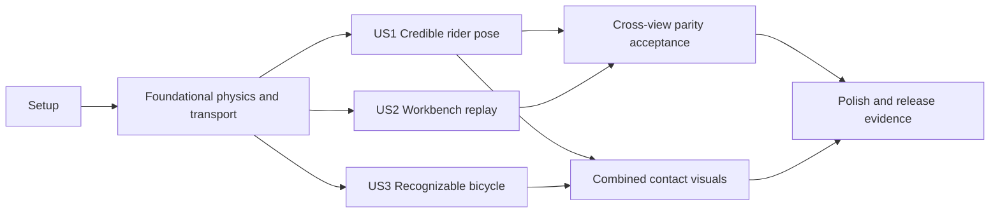

---

description: "Implementation tasks for coherent rider and bike geometry"
---

# Tasks: Coherent Rider and Bike Geometry

**Input**: Design documents from `/specs/003-rider-bike-geometry/`

**Prerequisites**: `plan.md`, `spec.md`, `research.md`, `data-model.md`, `contracts/`, `quickstart.md`

**Tests**: Required by FR-020, FR-021, FR-022, the validation contract, and the project constitution. Write focused failing tests before the corresponding implementation task. Numeric tolerances are defined in `specs/003-rider-bike-geometry/contracts/geometry-contract.md`.

**Organization**: Tasks are grouped by user story so each story remains independently testable after the shared physics and transport foundation is complete.

## Format: `[ID] [P?] [Story] Description`

- **[P]**: Can run in parallel with other marked tasks in the same phase because it changes different files and has no dependency on unfinished work.
- **[Story]**: Maps work to User Story 1, 2, or 3 from `spec.md`.
- Every task names the exact file or directory it changes.

## Phase 1: Setup (Shared Test Infrastructure)

**Purpose**: Establish reusable boundary scenarios and module entry points without adding dependencies.

- [X] T001 [P] Add reusable minimum/maximum rider and rigid/hardtail/full bike scenario builders in `tests/fixtures/ui/geometry-fixtures.ts`
- [X] T002 [P] Register the new pose-geometry regression module and harness path in `crates/physics-core/tests/regression.rs` and `crates/physics-core/tests/regression/pose_geometry.rs`

---

## Phase 2: Foundational (Blocking Prerequisites)

**Purpose**: Make Rust authoritative for canonical joint conventions, constrained rider/contact kinematics, and self-contained replay data before either Canvas consumes the new geometry.

**Critical**: Complete this phase before user-story implementation.

### Tests for the foundation

- [X] T003 [P] Write failing Rust tests for canonical joint signs, Rust-owned clamping, finite pedal-anchored leg geometry, handlebar-constrained elbow geometry, segment lengths and connected endpoints within `1e-5 m`, contact equality within `1e-5 m`, and neutral/constrained poses in `crates/physics-core/tests/regression/pose_geometry.rs`
- [X] T004 [P] Write failing schema tests for achieved pose landmarks, finite coordinate validation, additive named frame fields, and legacy frame-layout acceptance in `packages/schema/tests/run-result.test.ts`, `packages/schema/tests/worker-protocol.test.ts`, and `packages/schema/tests/application-contracts.test.ts`
- [X] T005 [P] Write failing native/worker parity tests for sampled landmarks, extended frame stride/offsets, fixture layout, native-to-WebAssembly pose agreement, and unchanged legacy readers in `tests/contracts/physics-worker.test.ts`, `tests/contracts/fixture-worker.test.ts`, and `tests/parity/physics-parity.spec.ts`

### Foundational implementation

- [X] T006 Document canonical bike-local axes, positive knee/elbow flexion, remaining joint signs, contact formulas, fixed-model proportions, and tolerances in `docs/physics/model.md`
- [X] T007 Implement target clamping, pedal and handlebar contacts, full finite side-plane rider kinematics, limiting reasons, and achieved pose landmarks in `crates/physics-core/src/pose.rs` and `crates/physics-core/src/geometry.rs`
- [X] T008 Extend `PoseSample` with strict achieved landmark/contact schemas and exported types in `packages/schema/src/run-result.ts` and `packages/schema/src/index.ts`
- [X] T009 Append achieved ankle/knee/hip/spine values and named rider/contact coordinates to each immutable frame while preserving existing offsets and layout version 1 in `crates/physics-core/src/solver.rs`
- [X] T010 Serialize achieved landmarks at the Rust WebAssembly boundary, update pose normalization and the additive frame manifest/stride, then run `npm.cmd run build:physics` to regenerate `crates/physics-core/pkg/` and `crates/physics-core/pkg-node/` from `crates/physics-core/src/lib.rs`, `apps/web/src/solver/physics.worker.ts`, and `apps/web/src/solver/gateway.ts`
- [X] T011 Update representative worker buffers and shared fixture factories to emit the extended fields while retaining an explicit old-layout fixture in `apps/web/src/solver/fixture.worker.ts` and `tests/fixtures/ui/demo-fixtures.ts`
- [X] T012 Apply the FR-021 bundled limit-sign correction so canonical rider joint limits match authored flexion targets, preserve authored targets, and remove TypeScript authority to reclamp physics samples in `tests/fixtures/scenarios/standard-v1.json`, `tests/fixtures/presets/catalog-v1.json`, and `apps/web/src/features/pose/pose-sampling.ts`

**Checkpoint**: Native Rust, schema, WebAssembly worker, and fixture worker agree on achieved pose values and landmark fields; old run layouts remain readable with full-rider posture unavailable.

---

## Phase 3: User Story 1 - Author a Credible Rider Pose (Priority: P1) MVP

**Goal**: Pose displays a finite, connected human riding posture with both limb pairs, a calculated elbow, valid hand/foot contacts, and synchronized constraint feedback.

**Independent Test**: Open `/pose`, select neutral/authored/constrained keys, adjust supported targets, and verify both arm and leg pairs remain connected, elbow is achieved-only, contacts coincide with bike anchors, and reset restores a credible stance.

### Tests for User Story 1

- [X] T013 [P] [US1] Extend Pose component tests for achieved landmarks, read-only calculated elbow values, Rust-returned limits, reset behavior, and unavailable-sample fallback in `apps/web/tests/unit/pose-editor.test.tsx`
- [X] T014 [P] [US1] Extend the Pose browser journey for paired limbs, achieved elbow synchronization, contacts, constraint reason, reset, keyboard behavior, and no new editable elbow target in `tests/e2e/pose.spec.ts`
- [X] T015 [P] [US1] Add neutral, authored, constrained, and rider-size boundary canvas assertions and reviewed snapshots in `tests/visual/pose.spec.ts`

### Implementation for User Story 1

- [X] T016 [P] [US1] Create the immutable rider-landmark adapter, near/far visual pairing, source classification, and unavailable state in `apps/web/src/rendering/geometry/rider-geometry.ts`
- [X] T017 [P] [US1] Create shared rider path and joint drawing primitives that preserve logical contacts and draw the far pair first in `apps/web/src/rendering/geometry/draw-rider.ts`
- [X] T018 [US1] Replace local five-point pose construction with physics-returned achieved/authored landmark rendering and stable fallback framing in `apps/web/src/rendering/canvas/pose-stage.ts`
- [X] T019 [US1] Pass achieved landmarks and limiting state through the Pose wrapper/editor without reclamping, and expose elbow as achieved-only in `apps/web/src/features/pose/PoseStage.tsx`, `apps/web/src/features/pose/usePoseEditor.ts`, and `apps/web/src/features/pose/JointRail.tsx`
- [X] T020 [US1] Add deterministic Pose geometry checkpoint data for sampled joints, logical contacts, source classes, and bike-local landmarks in `apps/web/src/test-hooks.ts`

**Checkpoint**: User Story 1 passes independently with the existing wheel/contact context even before the richer bicycle frame is delivered.

---

## Phase 4: User Story 2 - See the Authored Pose in Workbench (Priority: P1)

**Goal**: Workbench replays the exact immutable achieved posture from each run frame and matches Pose at the same movement coordinate without render-time sampling or decorative substitution.

**Independent Test**: Author a visibly bent-elbow key, apply without solving, solve once, seek the corresponding frame, and compare all six joint values, constraints, contacts, proportions, and bike-local landmarks between Pose and Workbench; verify continuous linear/cubic playback and explicit step boundaries.

### Tests for User Story 2

- [X] T021 [P] [US2] Extend Workbench component tests for all named pose/landmark field reads, complete rider-frame construction, and old-layout unavailable fallback in `apps/web/tests/unit/workbench.test.tsx`
- [X] T022 [P] [US2] Add Pose-to-Workbench no-solve handoff, same-coordinate parity within `1e-4 rad` and `1e-5 m`, linear/cubic continuity within `0.05 rad` per adjacent frame, step-boundary, and single-solve assertions in `tests/e2e/workbench.spec.ts` and `tests/e2e/pose.spec.ts`
- [X] T023 [P] [US2] Add authored-key, between-key, takeoff, flight, landing, and legacy-layout Workbench canvas assertions and snapshots in `tests/visual/workbench.spec.ts`

### Implementation for User Story 2

- [X] T024 [US2] Read the complete name-addressed achieved pose and landmark set from the selected immutable frame and construct the FR-022 explicit unavailable legacy posture state in `apps/web/src/features/workbench/WorkbenchPage.tsx`
- [X] T025 [US2] Thread achieved frame geometry through the stage wrapper without solver calls during playback, scrub, resize, camera, or overlay changes in `apps/web/src/features/workbench/WorkbenchStage.tsx`
- [X] T026 [US2] Replace the fixed rider stroke with shared articulated rider rendering transformed only by frame position/pitch in `apps/web/src/rendering/canvas/workbench-stage.ts`
- [X] T027 [US2] Add a Workbench geometry checkpoint and cross-view comparison helper using movement coordinate, six joints, contacts, constraint status, and bike-local landmarks in `apps/web/src/test-hooks.ts`
- [X] T028 [US2] Regenerate the canonical run artifact with extended fields and verify persistence/export round trips preserve unknown and new frame fields in `tests/fixtures/run-results/standard-v1.json`, `apps/web/tests/integration/persistence.test.ts`, and `apps/web/tests/unit/report-services.test.ts`

**Checkpoint**: User Story 2 passes with exact Pose/Workbench parity for new runs and an honest unavailable rider state for legacy layouts.

---

## Phase 5: User Story 3 - Inspect Recognizable Bicycle Geometry (Priority: P2)

**Goal**: Pose and Workbench show one recognizable, connected bicycle derived from physical dimensions and documented schematic proportions, with exact rider contacts and no invented measured suspension motion.

**Independent Test**: Load rigid, hardtail, and full-suspension scenarios in both views; identify wheels, axles, frame tubes, bottom bracket/crank/pedals, saddle, fork, steering, and handlebars; verify contacts align and representative geometry is disclosed.

### Tests for User Story 3

- [X] T029 [P] [US3] Write failing pure tests for deterministic proportion bounds, connected rigid/hardtail/full topology, authoritative contacts within `1e-5 m`, finite landmarks, and source classes in `apps/web/tests/unit/bike-geometry.test.ts`
- [X] T030 [P] [US3] Extend Pose and Workbench browser journeys for required bike landmarks, three frame types, contact alignment, schematic disclosure, and absence of invented suspension compression in `tests/e2e/pose.spec.ts` and `tests/e2e/workbench.spec.ts`
- [X] T031 [P] [US3] Add reviewed rigid/hardtail/full bicycle snapshots in both stages at desktop and tablet viewports in `tests/visual/pose.spec.ts` and `tests/visual/workbench.spec.ts`

### Implementation for User Story 3

- [X] T032 [P] [US3] Define the single documented representative proportion registry with reference dimensions, clamp bounds, and source metadata in `apps/web/src/rendering/geometry/proportions.ts`
- [X] T033 [US3] Derive connected wheel, axle, bottom-bracket, frame, saddle, crank/pedal, fork, steering, handlebar, pivot, and static shock paths around physics-returned contacts in `apps/web/src/rendering/geometry/bike-geometry.ts`
- [X] T034 [P] [US3] Create shared source-aware bicycle drawing primitives with distinct rigid/hardtail/full topology and no inferred compression in `apps/web/src/rendering/geometry/draw-bike.ts`
- [X] T035 [US3] Integrate shared bicycle geometry behind the rider in both Canvas stages and add concise schematic-geometry disclosure in `apps/web/src/rendering/canvas/pose-stage.ts`, `apps/web/src/rendering/canvas/workbench-stage.ts`, `apps/web/src/features/pose/PosePage.tsx`, and `apps/web/src/features/workbench/WorkbenchPage.tsx`

**Checkpoint**: User Story 3 passes independently for recognizable bicycle topology and source honesty; combined visual checks also confirm exact rider contacts.

---

## Phase 6: Polish & Cross-Cutting Concerns

**Purpose**: Close accessibility, responsive, performance, documentation, and acceptance evidence across all stories.

- [X] T036 [P] Extend accessibility coverage for existing Canvas names, calculated elbow text, limiting state, schematic disclosure, keyboard workflows, and non-color-only distinctions in `tests/e2e/accessibility.spec.ts`
- [X] T037 [P] Add desktop/tablet overflow, clipping, stable-stage-dimension, and complete-framing assertions for both views in `tests/visual/pose.spec.ts` and `tests/visual/workbench.spec.ts`
- [X] T038 [P] Update model scope, representative bicycle limitations, unavailable measured suspension compression, validation tolerances, and the FR-021 bundled joint-limit correction and FR-022 legacy-run posture disclosures in `docs/physics/model.md` and `docs/physics/limitations.md`
- [X] T039 Execute the focused and full commands from `specs/003-rider-bike-geometry/quickstart.md`, including `npm.cmd run test:parity`, `npm.cmd run test:determinism`, and `npm.cmd run benchmark:interaction` to confirm no render-time solve regression, then fix feature regressions and record reviewed command results in `specs/003-rider-bike-geometry/checklists/implementation-validation.md`
- [X] T040 Record the SC-003 recognition review and SC-004 under-60-second Pose-to-Workbench journey, including participants/results and remaining limitations, in `specs/003-rider-bike-geometry/checklists/acceptance-evidence.md`

---

## Dependencies & Execution Order

### Phase Dependencies

- **Setup (Phase 1)**: Starts immediately.
- **Foundational (Phase 2)**: Depends on Setup and blocks all user stories.
- **User Story 1 (Phase 3)**: Depends on Foundational; this is the MVP.
- **User Story 2 (Phase 4)**: Depends on Foundational for implementation and on User Story 1 for final cross-view parity acceptance.
- **User Story 3 (Phase 5)**: Depends on Foundational; recognizable bicycle work can begin alongside User Story 1 after shared contacts exist, but combined contact snapshots depend on User Story 1.
- **Polish (Phase 6)**: Depends on all selected user stories.

### User Story Dependency Graph



### Within Each Story

1. Write and run story tests so they fail for the intended missing behavior.
2. Implement pure models/adapters before stage integration.
3. Integrate state and Canvas rendering.
4. Run the independent story test and checkpoint before starting dependent acceptance work.
5. Update snapshots only after numeric and browser behavior checks pass.

## Parallel Opportunities

### Foundational

```text
T003 Rust kinematics tests
T004 Schema compatibility tests
T005 Worker parity tests
```

After T007-T009 establish outputs, T010 and T011 can proceed in parallel because they update solver and fixture worker paths separately.

### User Story 1

```text
T013 Pose component tests
T014 Pose E2E tests
T015 Pose visual tests
T016 Rider adapter
T017 Rider drawing primitives
```

T018 depends on T016 and T017. T019 and T020 can then proceed in parallel in feature-state and test-hook files.

### User Story 2

```text
T021 Workbench component tests
T022 Cross-view E2E tests
T023 Workbench visual tests
```

T024 precedes T025 and T026. T027 and T028 can proceed in parallel after complete frame geometry is available.

### User Story 3

```text
T029 Bike geometry tests
T030 Bike E2E tests
T031 Bike visual tests
T032 Proportion registry
```

T033 depends on T032. T034 can start once the output contract in T029 is fixed; T035 depends on T033 and T034.

## Implementation Strategy

### MVP First

1. Complete Setup and Foundational phases.
2. Deliver User Story 1 only.
3. Validate credible articulated Pose behavior independently.
4. Demonstrate before adding replay and richer bicycle topology.

### Incremental Delivery

1. **Foundation**: One physics-owned achieved pose and self-contained frame transport.
2. **US1 MVP**: Credible human geometry and calculated elbow in Pose.
3. **US2**: Exact immutable posture replay and Pose/Workbench parity.
4. **US3**: Recognizable source-honest bicycle geometry in both views.
5. **Polish**: Accessibility, responsive evidence, full verification, and stakeholder acceptance records.

### Completion Rule

A story is complete only when its numeric/contract tests, browser workflow, deterministic Canvas checkpoint, and independent test criteria pass. Visual similarity alone is not physics or contact validation.
