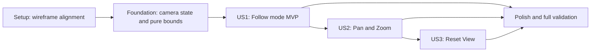

---

description: "Implementation tasks for Workbench camera modes"
---

# Tasks: Workbench Camera Modes

**Input**: Design documents from `/specs/004-workbench-camera-modes/`

**Prerequisites**: `plan.md`, `spec.md`, `research.md`, `data-model.md`, `contracts/`, `quickstart.md`

**Tests**: Required by the validation matrix and project constitution. Write focused failing tests before the corresponding implementation task. Camera behaviour and numeric bounds are defined in `specs/004-workbench-camera-modes/contracts/camera-contract.md`.

**Organization**: Tasks are grouped by user story so each increment is testable at its phase boundary;
later stories intentionally build on the completed camera behaviour from earlier stories.

## Format: `[ID] [P?] [Story] Description`

- **[P]**: Can run in parallel with other marked tasks in the same phase because it changes different files and has no dependency on unfinished work.
- **[Story]**: Maps work to User Story 1, 2, or 3 from `spec.md`.
- Every task names the exact file or directory it changes.

## Phase 1: Setup (UX Contract Alignment)

**Purpose**: Reconcile the governing wireframe contract with the approved feature deviation before implementation.

- [X] T001 [P] Update Workbench wireframe region 12 from Fit / Follow / Lip and persisted px/m zoom to Follow / Pan & Zoom, Reset View, relative zoom, keyboard controls, and session-only state in `ui_wireframes/workbench.html`
- [X] T002 [P] Update the rendered Workbench prototype camera controls and demonstrated interactions to match the approved contract while preserving `camera-mode` and adding `camera-reset` in `ui_wireframes/rendered_html/workbench.html`

---

## Phase 2: Foundational (Blocking Prerequisites)

**Purpose**: Establish shared camera types, session state, pure geometry inputs, and deterministic test access before user-story implementation.

**Critical**: Complete this phase before all user-story implementation.

### Tests for the foundation

- [X] T003 [P] Write failing store tests for default Follow mode, shared zoom persistence, nullable manual state, identity transitions that reset mode/pan but preserve zoom, explicit Reset View zoom reset, session-only scope, and exclusion from scenario/run data in `apps/web/src/state/store.test.ts`
- [X] T004 [P] Write failing camera-module contract tests for finite deterministic bounds, degenerate stage sizes, model extents, and legacy frames without landmarks in `apps/web/tests/unit/workbench-camera.test.ts`

### Foundational implementation

- [X] T005 Define `CameraMode`, `ManualCameraState`, `CameraViewState`, `ModelExtent`, `CameraView`, clamp constants, and pure geometry helpers in `apps/web/src/rendering/canvas/camera.ts`
- [X] T006 [P] Add default Follow camera state, shared zoom factor, and typed camera actions to the session slice; identity changes reset mode/pan but preserve zoom, and only Reset View restores 1x in `apps/web/src/state/store.ts`
- [X] T007 [P] Extract reusable world-space rider-and-bike extent calculation from the existing drawing geometry and implement the rider-height fallback for legacy frames in `apps/web/src/rendering/canvas/workbench-stage.ts` and `apps/web/src/rendering/canvas/camera.ts`
- [X] T008 [P] Add camera checkpoint types, registration lifecycle, and `getCameraCheckpoint` exposure without influencing runtime state in `apps/web/src/test-hooks.ts`

**Checkpoint**: Camera types and session transitions are stable, pure extent/bounds primitives are finite for current and legacy frames, and deterministic checkpoints are available to browser tests.

---

## Phase 3: User Story 1 - See the Bike Clearly by Default (Priority: P1) MVP

**Goal**: Workbench opens in Follow mode with the complete rider-and-bike model occupying 28-36% of stage height, targeting 32%, positioned 32-38% from the left edge with relevant terrain ahead and the takeoff visible once it enters the forward view.

**Independent Test**: Open `/workbench` at supported desktop and tablet sizes without touching camera controls, then seek through approach, takeoff, flight, and landing and switch active scenario/run identities; verify Follow mode, 28-36% model height, 32-38% horizontal position, terrain ahead, identity resets, adaptive geometry, and no clipping.

### Tests for User Story 1

- [X] T009 [P] [US1] Extend camera unit tests for the 32-38% horizontal band, 28-36% model-height band, distant-takeoff precedence, takeoff entry into the forward view, terrain-ahead composition after takeoff, and minimum/standard/maximum valid approach and jump geometries in `apps/web/tests/unit/workbench-camera.test.ts`
- [X] T010 [P] [US1] Extend Workbench component tests for Follow default, exactly two mode options, continuous mode indicator, and camera checkpoint registration in `apps/web/tests/unit/workbench.test.tsx`
- [X] T011 [P] [US1] Add deterministic Follow checkpoints across approach, takeoff, flight, and landing plus active scenario/run identity workflows, preserving zoom through solves/mode changes and asserting no additional solve dispatch in `tests/e2e/workbench.spec.ts`
- [X] T012 [P] [US1] Add desktop/tablet canvas pixel checks and reviewed snapshots for 28-36% model scale, takeoff/terrain visibility, nonblank output, no clipping, and no page overflow in `tests/visual/workbench.spec.ts`

### Implementation for User Story 1

- [X] T013 [US1] Implement pure Follow view resolution from model extent, stage aspect ratio, 32-38% horizontal placement, 28-36% model sizing targeting 32%, distant-takeoff precedence, and scenario-adaptive bounds in `apps/web/src/rendering/canvas/camera.ts`
- [X] T014 [US1] Replace the hardcoded full-scenario bounds and `cameraShift` branch with camera-resolved bounds, and range grid/terrain/trajectory drawing to the visible view in `apps/web/src/rendering/canvas/workbench-stage.ts`
- [X] T015 [US1] Replace local `cameraMode = "fit"` state with session-backed Follow camera state and expose mode actions/checkpoint data in `apps/web/src/features/workbench/useWorkbench.ts`
- [X] T016 [US1] Render Follow and Pan & Zoom options in the preserved `camera-mode` region and keep the stage mode badge synchronized in `apps/web/src/features/workbench/WorkbenchPage.tsx` and `apps/web/src/features/workbench/WorkbenchStage.tsx`

**Checkpoint**: User Story 1 passes as the MVP increment; the Workbench is immediately readable in Follow mode even before manual camera interactions or Reset View are delivered.

---

## Phase 4: User Story 2 - Freely Inspect with Pan & Zoom (Priority: P2)

**Goal**: Users can enter Pan & Zoom and hold a manual world-space view while inspecting the run through pointer, touch, wheel/pinch, and keyboard inputs, bounded to 0.5x-3x of the default Follow zoom.

**Independent Test**: Switch from Follow to Pan & Zoom, pan and zoom through every input path, play/pause/scrub/resize, and verify the chosen view remains unchanged except for explicit camera inputs and saturates exactly at 0.5x and 3x.

### Tests for User Story 2

- [X] T017 [P] [US2] Extend camera unit tests for manual-centre authority, Follow-to-manual continuity, pointer-anchored zoom math, resize preservation, and exact 0.5x-3x clamping in `apps/web/tests/unit/workbench-camera.test.ts`
- [X] T018 [P] [US2] Extend Workbench component tests for stage focusability, visible camera mode/readout state, and pointer, wheel, arrow, plus, and minus event dispatch in `apps/web/tests/unit/workbench.test.tsx`
- [X] T019 [P] [US2] Add pointer drag, wheel/pinch, arrow-key, plus/minus, clamp, direct-mode-switch, and play/pause/scrub stability workflows with unchanged solve count/run data in `tests/e2e/workbench.spec.ts`
- [X] T020 [P] [US2] Add keyboard reachability, visible focus, accessible names, and touch-target coverage for camera controls and the interactive stage in `tests/e2e/accessibility.spec.ts`

### Implementation for User Story 2

- [X] T021 [US2] Implement manual-centre view resolution, Follow-view seeding, world-delta panning, pointer-anchored zoom, multiplicative keyboard zoom, and 0.5x-3x clamping in `apps/web/src/rendering/canvas/camera.ts`
- [X] T022 [US2] Add typed Pan & Zoom transitions and immutable pan/zoom updates that remain unchanged across playback, scrub, pause, solve, and resize in `apps/web/src/features/workbench/useWorkbench.ts`
- [X] T023 [P] [US2] Implement pointer/touch drag, wheel/pinch, arrow-key pan, plus/minus zoom, focus management, and cleanup in `apps/web/src/features/workbench/WorkbenchStage.tsx`
- [X] T024 [P] [US2] Wire Pan & Zoom mode selection and bounded relative zoom readout into the camera toolbar without changing playback or solver dispatch in `apps/web/src/features/workbench/WorkbenchPage.tsx`

**Checkpoint**: User Story 2 passes as an increment over User Story 1, with manual framing held stable through all playback operations and no physics/run mutation.

---

## Phase 5: User Story 3 - Reset to a Sane View (Priority: P3)

**Goal**: A single Reset View action clears any manual camera state and returns to Follow at the default zoom around the bike's current frame without affecting playback.

**Independent Test**: Pan and zoom away from the bike, seek or play to a nonzero frame, activate Reset View once, and verify Follow mode, zoom factor 1, current-frame composition, unchanged playback/run state, and availability in both camera modes.

### Tests for User Story 3

- [X] T025 [P] [US3] Extend store and Workbench component tests for Reset View availability in both modes, clearing manual state, restoring Follow, and preserving the current frame in `apps/web/src/state/store.test.ts` and `apps/web/tests/unit/workbench.test.tsx`
- [X] T026 [P] [US3] Add one-interaction Reset View workflows from both modes and during mid-playback, asserting current-frame Follow framing, default zoom, and unchanged solve count/run id in `tests/e2e/workbench.spec.ts`

### Implementation for User Story 3

- [X] T027 [US3] Add a Reset View action that atomically sets Follow mode and clears manual camera state without changing playback or run state in `apps/web/src/features/workbench/useWorkbench.ts`
- [X] T028 [US3] Add the always-available Zoom slider and icon-based Reset View control with accessible names, tooltip, stable `camera-reset` id, and explicit-only 1x reset in `apps/web/src/features/workbench/WorkbenchPage.tsx`

**Checkpoint**: User Story 3 passes as an increment over User Stories 1 and 2; one action always recovers a known-good Follow view at the current simulation frame.

---

## Phase 6: Polish & Cross-Cutting Concerns

**Purpose**: Close responsive, performance, UX-contract, and acceptance evidence across all stories.

- [X] T029 [P] Verify the updated wireframe source and rendered prototype preserve all required Workbench region ids, toolbar fit, 44px touch targets, and approved camera semantics in `tests/contracts/wireframe-input-inventory.test.ts` and `ui_wireframes/rendered_html/workbench.html`
- [X] T030 [P] Extend visual coverage for extreme scenario geometry, legacy frames, maximum/minimum zoom, stage resize, overlays, and baseline rendering at desktop and tablet sizes in `tests/visual/workbench.spec.ts`
- [X] T031 [P] Add interaction benchmark assertions that repeated pan/zoom maintains input-to-paint p95 <=100 ms, FPS >=55, zero dropped frames, and zero presentation solver dispatches in `tests/benchmarks/interaction.bench.ts`
- [X] T032 Run every focused and full command from `specs/004-workbench-camera-modes/quickstart.md`, fix feature regressions, and verify every row in `specs/004-workbench-camera-modes/contracts/validation-matrix.md` has passing executable evidence

---

## Dependencies & Execution Order

### Phase Dependencies

- **Setup (Phase 1)**: Starts immediately and documents the approved UX-contract change.
- **Foundational (Phase 2)**: Depends on Setup and blocks all user stories.
- **User Story 1 (Phase 3)**: Depends on Foundational and is the MVP.
- **User Story 2 (Phase 4)**: Depends on the Follow view produced by User Story 1 so manual mode can seed continuously from it.
- **User Story 3 (Phase 5)**: Depends on User Stories 1 and 2 because Reset clears manual state and restores the Follow view.
- **Polish (Phase 6)**: Depends on all selected user stories.

### User Story Dependency Graph



### Within Each Story

1. Write and run story tests so they fail for the intended missing behaviour.
2. Implement pure camera math before feature/state or Canvas integration.
3. Wire session actions before DOM interaction handlers and toolbar controls.
4. Run the independent story test and checkpoint before starting the next story.
5. Update snapshots only after numeric camera and browser behaviour checks pass.

## Parallel Opportunities

### Setup

```text
T001 Wireframe contract sheet
T002 Rendered prototype
```

The two files can be edited in parallel, then reviewed together for contract consistency.

### Foundational

```text
T003 Store tests
T004 Camera contract tests
```

After T005 fixes the types, T006 (store), T007 (geometry extents), and T008 (test hooks) touch separate ownership surfaces and can proceed in parallel where their imported type contract is stable.

### User Story 1

```text
T009 Follow camera unit tests
T010 Workbench component tests
T011 Follow E2E checkpoints
T012 Follow visual tests
```

T013 precedes T014. After camera bounds render correctly, T015 and T016 can proceed across state and UI files with coordination around the shared props contract.

### User Story 2

```text
T017 Manual camera unit tests
T018 Interaction component tests
T019 Pan and Zoom E2E workflows
T020 Camera accessibility tests
```

T021 precedes T022 and T023. T023 and T024 can proceed in parallel after T022 fixes the interaction action contract.

### User Story 3

```text
T025 Reset unit/component tests
T026 Reset E2E workflow
```

T027 precedes T028 because the control consumes the reset action.

### Polish

```text
T029 Wireframe contract verification
T030 Extended visual edge cases
T031 Camera interaction benchmark
```

## Implementation Strategy

### MVP First

1. Complete Setup and Foundational phases.
2. Deliver User Story 1 only.
3. Validate Follow framing numerically and visually at desktop and tablet viewports.
4. Demonstrate the corrected default before adding manual interactions.

### Incremental Delivery

1. **Foundation**: Typed session camera state, pure extents, finite deterministic bounds, test checkpoint.
2. **US1 MVP**: Follow-by-default with readable, adaptive model framing.
3. **US2**: Stable manual inspection across all pointer, touch, wheel, and keyboard inputs.
4. **US3**: One-action recovery to current-frame Follow framing.
5. **Polish**: Wireframe conformance, edge-case visuals, performance, and full validation matrix.

### Completion Rule

A story is complete only when its unit/component tests, browser workflow, deterministic camera checkpoint, and relevant canvas pixel checks pass. The feature is complete only when the approved wireframe deviation is reflected in both wireframe sources and every row of the validation matrix has executable evidence.
